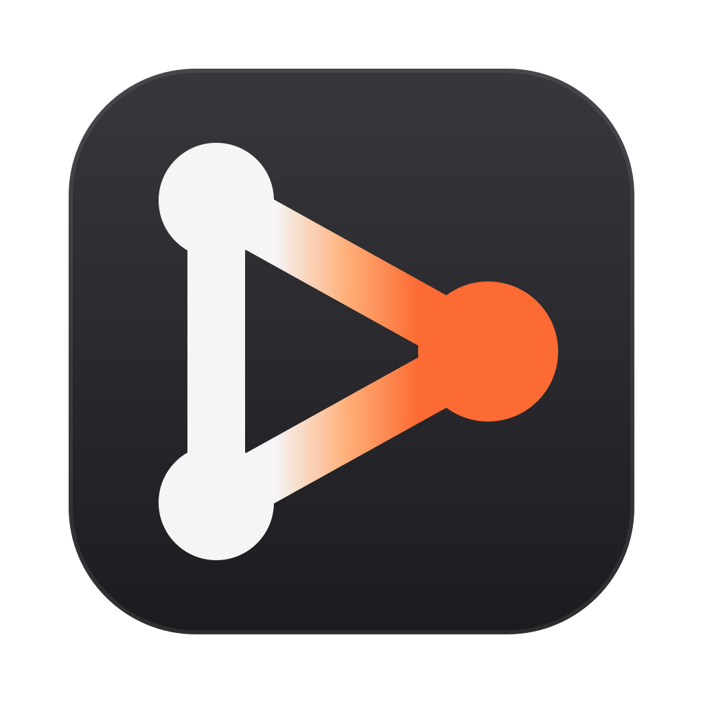

<p align="center">
  
</p>

<h1 align="center">Opsis</h1>

<p align="center"><b>Record a real website or terminal and turn it into a polished product demo.</b></p>

Opsis is a desktop app with a node editor. Browser and terminal nodes drive a real website or shell (clicks, typing, scrolling, commands) and record it in one take; camera, cursor, text, motion-graphics, transition, audio and media nodes turn the recording into a finished video, exported in several shapes at once. Everything runs on your computer. 💻

> 🚧 **Early preview.** Opsis hasn't had a release yet. It is built and tested on Linux, where the deb, rpm, AppImage and pacman packages install and run. Windows and macOS builds don't work yet, and the installers aren't code signed. Expect rough edges.

Built with Rust, [Qt](https://www.qt.io) Widgets and [KDDockWidgets](https://github.com/KDAB/KDDockWidgets) for the editor, Skia and Filament for drawing films, Ghostty's terminal engine, and FFmpeg. Work that's planned but not built lives in [`plans/`](./plans).

## ✨ What it does

### 🎬 Record

- **A real browser:** 18 actions, from go to page, click, type, hover, drag (onto an element, by a distance or along a path) and scroll to choose option, upload file, press keys, wait, check text, find an element early, fake a response, freeze time, hide clutter, page scripts, chapters and HTML overlays.
- **Sign in once:** a Sign in node saves the login and reuses it in every take; a Start recording node keeps the setup off camera.
- **A real terminal:** run commands, type, press keys, click, drag, scroll the wheel and wait for text in bash, zsh or PowerShell, and record it with any terminal colour theme. Play a VHS tape, use an asciinema cast file as a take, or record a new tape by typing in a terminal window, and export any session back as a tape.
- **Watch it happen:** a live view of the recording, and a replay of every take with its trace.

### 🎥 Camera and cursor

- A camera that zooms to every action or follows the cursor, camera moves you place yourself, speeding up quiet parts and speed ramps; crop, laptop and phone frames, macOS, Windows and Linux window frames (light or dark, with the page address), studio backgrounds and motion blur.
- Cursor styles (a simple arrow, or a Mac cursor that turns into a hand over links and a text cursor over fields), click ripples, keystroke chips, spotlights and highlight boxes, clean or hand-drawn.
- Blurred areas that hide private details and stay on the page while the camera moves.
- Cursor, marks, frame and background settings form a style that one take or several share.

### 🎨 Graphics, 3D and transitions

- **More than a hundred elements:** animated text, title cards, text highlights, arrows, charts, logo sets and reveals, UI scenes, device frames, backgrounds and film looks, each family one node with a kind to pick; your images, videos and Lottie animations (`.json` and `.lottie`) as clips; a redact effect (large pixels, blur or a solid colour) for hiding details; and a picture look (colour, dark edges, film grain).
- **3D:** one 3D object node for a logo, an image card, text in any project font or a model from your project with its own animations, a clip on a 3D laptop, monitor, phone or floating screen that ends facing the camera, and floating shapes as a background; camera keyframes set in the Inspector and dragged on the Timeline.
- **25 transitions plus a light-leak cut and spring settle.** A Transition node puts one on the clip it brings in, so every join in a Sequence can have its own transition, length and hold.

### 🔤 Text and fonts

- 16 bundled font families, and a font library you fill from font files or ZIPs, fonts installed on your computer, or free fonts downloaded online (only when you ask).
- Projects set fonts for text, headings and code, and copy the fonts they use so they open anywhere.

### 🔊 Audio

- Music with fades and ducking under sound effects (3 built-in CC0 songs or your own files), fitted to the film by stretching it a little or looping it with a crossfade.
- Sound effects (8 built-in CC0 sounds, your own files, or sounds made from settings: whoosh, riser, swell, pop, ding, tap, click, tone, beep and countdown) at a time, on an action, or ending on an action, a marker or the clip's end with a hit; click and key sounds at every action of a take; a whoosh at every transition; room tone, and captions timed from a script.
- **The Mixer:** a strip per sound with trim, low cut, 4-band EQ, compressor, pan, fader, mute and solo, grouped under buses with their own EQ, compressor, presets and sidechain ducking; a master with EQ, compressor, limiter and loudness targets (−14, −16, −23 LUFS). Exports play exactly the rendered mix, and a mix change only adds the new sound to the picture already rendered.

### 🎞️ Media and images

- **Video and sound:** trim, join, speed (up to 64×), reverse, resize, convert (a web-ready copy included), GIF, extract audio, even out volume, grab a frame; remove noise, soften "s" sounds, fix clicks, fix clipping, remove hum, shorten pauses, change pitch, voice effects (telephone, radio, rooms, echo) and a picture of the waveform or spectrum.
- **Images:** resize, crop, rotate and flip, straighten, frame in a window or on a laptop or phone, flat or tilted in 3D, colour fixes through the same grade nodes as video, place a logo, redact, spotlight, trim empty edges, make a colour transparent, outline, grids, before and after, magnify, compare two screenshots, annotate, and save as PNG, JPEG, WebP or AVIF. Phone photos come out the right way up and in the right colours.

### 📤 Export

- 16:9, 9:16, 1:1 and 4:5 in one go. Other shapes keep the whole window and zoom in closer on the action, with captions and lower thirds kept clear of the edges.
- Video files carry the film's chapters for players that list them, with an optional chapter list to paste into a YouTube description.
- Stills in social sizes, a take's own recording, and terminal sessions as tapes.

### 🧭 The editor

- More than 250 node types, 7 sample projects, undo and redo, groups and auto layout.
- **Timeline:** the film as bars with filmstrips, waveforms, action marks, chapters, markers and music beats; move, trim, split, ripple, roll, slip, speed and keyframes, each written back to the nodes as one undo step; snapping, J/K/L, in and out points.
- Timeline, Mixer, Run and Script are tabs, and any panel can pop out into its own window. The canvas has a mouse mode and a touchpad mode and a minimap you can hide.
- New projects go to `~/OpsisProjects` (changeable in Settings). If the project file changes on disk while it's open, the editor loads it, or asks first when you have unsaved edits; it never saves over a change it hasn't seen.
- Settings has pages for General, Projects, Editor, Engine, Recording, Fonts, API, Licences and About.

### 🔌 Local API

Off by default; switch it on in **Settings → API**. Scripts and AI agents on your computer can then read, change and run the open project over plain HTTP on a local socket (`api.sock` in the app's data folder, or the full path in `OPSIS_API_SOCKET`, at most 100 bytes long; a named pipe on Windows). `GET /openapi.json` describes every route, and every edit is one undo step in the editor.

### 📜 Lua scripts

Write Lua in the **Script** tab (`scripts/*.lua` in the project) and run it with Ctrl+Enter. The `opsis` module reaches everything the editor does with the open project: nodes, connections, variables, the timeline, the mixer, runs and exports. A script reads and writes only files inside the project folder and never uses the internet, and one that fails or is stopped undoes its changes to the project; one that finishes is a single undo step. With **Run Lua scripts** switched on in Settings → API, `POST /project/script` runs one too.

### 🔄 Updates

A copy installed from a release package checks for updates when you click **Check for updates** in Settings → About, or at start if you turn that on. The AppImage, Windows and macOS installs download the signed update and install it when Opsis closes; deb, rpm and pacman installs open the release page instead.

## 🚀 Getting started

You need:

- [Bun](https://bun.sh), and Node.js 22.12 or later for the TypeScript tests
- [rustup](https://rustup.rs) (the repository pins its nightly, which rustup installs by itself)
- [cargo-deny](https://github.com/EmbarkStudios/cargo-deny) for `bun run lint:fix` (`cargo install cargo-deny`)
- [uv](https://docs.astral.sh/uv/), which `bun run qt:install` uses to fetch Qt
- CMake and a C++ compiler
- on Linux, the sound library and Qt's X11 libraries (on Ubuntu: `libasound2-dev libxcb-cursor0 libxkbcommon-x11-0 libxcb-icccm4 libxcb-image0 libxcb-keysyms1 libxcb-render-util0 libxcb-xinerama0 libxcb-randr0 libxcb-shape0 libxcb-xkb1`)

```sh
bun install
bun run zig:install      # Zig 0.17 into ~/.cache/opsis-dev/zig; put the folder it prints on your PATH
bun run qt:install       # Qt 6.12 and KDDockWidgets into ~/.cache/opsis-dev/qt
bun run skia:build       # Skia into ~/.cache/opsis-dev/skia (add --docker to build in a container)
bun run filament:pin --fetch
bun run filament:build   # the Filament wrapper into ~/.cache/opsis-dev/filament (needs clang and libc++, or --docker)
bun start
```

Skia and Filament build once into `~/.cache`; run `bun run filament:build` again after changing `crates/filament/cpp`. `bun start` downloads the pinned FFmpeg into `target/ffmpeg/` the first time, builds the renderer program and runs the app.

The first time, open **Settings → Engine** and either **Download engine**, which puts the recording browser (Chrome Headless Shell) in the app's data folder, or **Choose file…** for one you already have. Editing, mixing and exporting work without it; recording needs it, and so does exporting with **Draw with: Software**, which uses its graphics driver. Then **New project → Sample: to-do app → Run**. 🎉

Ready-made copies of every sample are in [`examples/`](./examples) (**Open project…**).

## 📦 Building

`bun run make` stages everything the app ships, builds the release binary against a static Qt and packages it into `~/.cache/opsis-dev/build`: the deb on Linux, the app and DMG on macOS, NSIS and MSI on Windows. Pick others with `bun run make -- --formats deb,rpm,appimage,pacman`.

- On Linux the static Qt, the release binary and its packages build in a plain `debian:trixie` container, so you need Docker; the program then needs glibc 2.41.
- The Rust build uses 8 jobs unless `CARGO_BUILD_JOBS` says otherwise.
- The app ships FFmpeg (the pinned ffmpeg-static build, as the `opsis-ffmpeg` program beside its own) and the renderer program (`opsis-renderer`), but never the recording browser.
- CI checks every push ([`build.yml`](./.github/workflows/build.yml)); the release workflow ([`release.yml`](./.github/workflows/release.yml)) builds the installers on `v*` tags or by hand and drafts the release on tags.

## 🛠️ Scripts

| Script                   | What it does                                                                                      |
| ------------------------ | ------------------------------------------------------------------------------------------------- |
| `bun start`              | Run the app in development                                                                        |
| `bun run typecheck`      | Type-check the scripts                                                                            |
| `bun run lint:fix`       | oxlint, Clippy, `cargo deny`, the Zig wrapper build, clang-tidy and the comment check             |
| `bun run format:fix`     | oxfmt, `cargo fmt`, `zig fmt` and clang-format                                                    |
| `bun run test`           | Vitest and `cargo test` (with the staged FFmpeg)                                                  |
| `bun run e2e:qt`         | The editor driven through its scenarios in a virtual display (needs `xvfb`; `sway` for `wayland`) |
| `bun run skia:build`     | Build the pinned Skia (`--docker` in a container)                                                 |
| `bun run filament:build` | Build the sealed Filament wrapper (`--docker` in a container)                                     |
| `bun run types:export`   | Write the scripts' font types from the Rust code                                                  |
| `bun run make`           | Build the release program and its installers                                                      |
| `bun run package:check`  | Install each Linux package in a plain `debian:trixie` container and run it                        |
| `bun run examples`       | Rewrite the projects in `examples/` from the templates                                            |

## 🏗️ How it works

```
Editor (Qt 6 Widgets + KDDockWidgets, C++ views over a cxx bridge)
   canvas · node list · inspector · timeline · mixer · run panel
                          │ views and calls
Rust: the open project, compiles, runs, settings, fonts, the Local API, updates
   compile (graph → TimelineSpec) · runner (keys → cache → executors → events)
   browser capture over CDP · terminal takes on Ghostty · FFmpeg · images · 3D files
   the renderer: scene → layout (Taffy, Parley) → paint (Skia) → raw frames → FFmpeg
          │ CDP                                    │ pipe
Chrome Headless Shell: recording,          opsis-renderer: shader effects and 3D
sign-in, element picker                    on Filament (graphics card or software)
```

- **Nodes never generate film code.** They produce files and compile to a `TimelineSpec`; one walker turns any spec into a scene per frame, which Rust lays out, paints and sends to FFmpeg.
- **Nodes pass resources forward:** a browser or terminal session, a take, a style, clips, files, images, sounds and captions. Browser and terminal actions add to their session, and the record node plays them in one continuous take.
- **Caching:** every node is hashed from its type, settings and the hashes before it; results are kept in `.opsis/cache/<hash>`, so only changed branches run again.

| Folder        | What's there                                                                                |
| ------------- | ------------------------------------------------------------------------------------------- |
| `crates/`     | Rust, one domain per crate: the session, compile, runs, capture, media, the editor and more |
| `fixtures/`   | Golden files: what the code made for fixed inputs, pictures included                        |
| `scripts/`    | Bundling, pinning, packaging, profiling and the shared tool configs                         |
| `agent-docs/` | How each part works, and why                                                                |

## 🤔 Why it's built this way

| Decision          | Choice                                                                                                     | Why                                                                                                                                   |
| ----------------- | ---------------------------------------------------------------------------------------------------------- | ------------------------------------------------------------------------------------------------------------------------------------- |
| App shape         | One native app: Rust for everything that touches the system and owns the state, the editor in Qt Widgets   | A typed boundary, native widgets and docking, and one place (Rust) that owns the project, runs, settings and the state windows share. |
| Types and logic   | Rust is the source; the editor's views are the bridge's structs, the scripts' types are generated (specta) | Views, calls and the timeline spec can't drift apart, and the editor keeps no copy of logic Rust already has.                         |
| Canvas            | Our own canvas on `QGraphicsView`, with layout and edge lanes worked out in Rust                           | Cards, ports, edges and the minimap drawn natively, and the same maths the Local API and tests use.                                   |
| Workflow format   | A versioned JSON graph, compiled in Rust to one `TimelineSpec`                                             | The graph is for people; the spec is the single input the video renders from.                                                         |
| Video engine      | Our own renderer: scene nodes in a CSS and SVG subset, Taffy and Parley, Skia on the CPU, Filament         | Every frame is drawn the same on every computer, in parallel chunks straight into FFmpeg, with no browser in a render.                |
| Browser           | One Chrome Headless Shell for recording, sign-in and the element picker, driven over CDP from Rust         | The same engine everywhere; Playwright's page scripts and keyboard are reused without its Node runtime.                               |
| Terminal          | Ghostty's terminal engine, drawn by the same code as the film                                              | A real terminal's behaviour, and the editor shows exactly what the export draws.                                                      |
| Animations        | Frame-driven only: every element and transition                                                            | Every frame has to be a pure function of the frame number; CSS transitions and tween libraries don't survive a render.                |
| GSAP              | Not used                                                                                                   | Opsis's own `interpolate`, `spring` and easing cover it.                                                                              |
| FFmpeg            | The ffmpeg-static build, pinned by sha256 and shipped beside the app as a separate program                 | Exports work without setting anything up, and every run starts the same known build.                                                  |
| Camera and cursor | Built on [programatic-demo](https://github.com/ashrafchowdury/programatic-demo) (MIT)                      | It already solved the click log, auto-zoom camera, vector cursor and motion blur; its notice is kept.                                 |
| Offline           | Nothing uses the internet unless you ask                                                                   | Engine, font and update downloads sit behind a button or a setting you turn on, and a film never loads anything remote.               |
| Licensing         | GPLv3 or later                                                                                             | Free software, with no other licence needed to export.                                                                                |

## 🤝 Contributing

See [CONTRIBUTING.md](./CONTRIBUTING.md) for setting up, the checks to run and the rules the code follows, and [SECURITY.md](./SECURITY.md) for reporting a vulnerability.

## 📜 Licences

Opsis is free software under the [GNU General Public License version 3 or later](./LICENSE). Videos you make with Opsis are yours: the licence covers the program, not what it makes.

Bundled and vendored third-party code, fonts, sounds, FFmpeg and the recording browser keep their own licences; see [THIRD_PARTY_NOTICES.md](./THIRD_PARTY_NOTICES.md).
